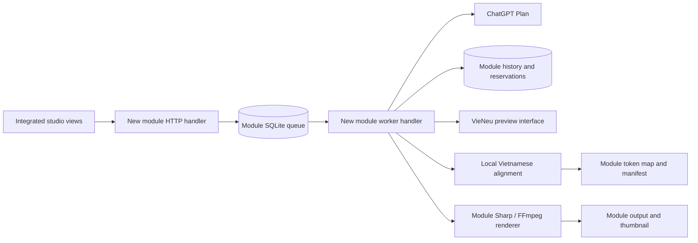

# Một Phút Vỡ Lẽ: dependency and integration map

## Isolated module

`src/mot-phut-vo-le/` owns the content schema, prompts, open topic discovery, duplicate checks, history, job records, settings, visual presets, TTS wrapper, alignment manifest, renderer, thumbnail, HTTP handler, and worker handler.

Persistent module data is isolated under `DATA/mot-phut-vo-le/`:

- `history.sqlite` stores topic/content history and this module's queue.
- `settings.json` stores this module's generation defaults.
- `visual-presets.json` stores this module's Visual Editor design and presets.
- `audio-cache/` stores audio keyed by module version, text, voice, language, and speed.
- `content/<id>/` stores source audio and alignment manifests.
- `DATA/outputs/mot-phut-vo-le/<id>/` stores versioned MP4 and PNG output.

No rows, keys, files, or caches are written to the existing content database, English Shadowing state, or shared audio cache by this module.

## Existing services reused through their current exports

| Service | Existing entry point | Interface used | Isolation boundary |
| --- | --- | --- | --- |
| ChatGPT Plan | `src/ai/chatgpt-plan.mjs` | `chatgptStatus()`, `generateWithChatGPT(prompt)` | Dynamically loaded only when generation/status is requested; keeps existing auth and available-model discovery. |
| VieNeu-TTS | `src/tts/vieneu-tts.mjs` | `VIENEU_VOICES`, `vieneuModelStatus(settings)`, `synthesizeVieNeuPreview(...)` | Preview API writes to module-owned paths; module maintains its own versioned cache. |
| Local forced alignment | `src/tts/local-alignment.mjs` | `alignSpeechLocally(audioPath, text, 'vi')` | Called with explicit Vietnamese; mapping and manifest belong to this module. |
| Token mapping | `packages/audio-highlight/highlight-engine.mjs` | `mapWordBoundariesToTokens(text, boundaries, id, {language:'vi'})` | Existing implementation is imported read-only; no shared changes. |
| Video tools | `src/config.mjs`, installed `sharp`, FFmpeg and FFprobe | path/profile constants, rasterization, encode and probe | New renderer writes only to module output and temporary-frame folders. |

## Dependency flow

The new content mode is available in the existing studio selector, with its own fields, settings, and library rows. Its Visual Editor profile lives inside the existing Shadowing workspace and exposes only Thumbnail and Content design. The content renderer reads the shared highlight defaults without changing that package; the Shadowing-specific highlight controls remain attached to the EnglishShadowing profile. The main server dispatches only the exact `/api/mot-phut-vo-le/` prefix to the new handler. The module starts its own child worker only when its queue has work; that worker drains the module SQLite queue and exits after 30 seconds idle. It does not use the shared worker queue or persist the selected module mode as an existing language setting. VieNeu synthesis uses its existing inter-process model lock, so two calls cannot write to the same local model simultaneously.

## Isolated application wiring

The shared UI contains narrow integration points for the module. All module configuration and job handling stays in its own API and storage branch.

| Existing file | Minimal addition | Isolation boundary |
| --- | --- | --- |
| `src/server.mjs` | Dispatch paths beginning exactly `/api/mot-phut-vo-le/` to the module handler. | The branch returns immediately. Existing API paths continue through the existing dispatcher. |
| `public/index.html` | Add a content option, create fields, library filter, and a separately stored settings panel. | The module is not written to the shared `contentLanguage` setting. |
| `public/app.js` | Dispatch generation and library refreshes to the module API only for `mot-phut-vo-le`. | Existing EN/ZH request bodies and settings remain unchanged. |
| `public/visual-editor.html` | Add a profile selector within the Shadowing workspace and a separate module design panel. | The existing EnglishShadowing editor and its controls remain intact. |
| `public/mot-phut-visual-editor.js` | Save module design to the module visual-design endpoint and render its previews. | No Shadowing endpoint or shared template is written. |
| `src/mot-phut-vo-le/worker-process.mjs` | Start a separate child process for this module's own queue. | `src/workers/worker.mjs` is untouched. The child exits after the module queue is idle for 30 seconds. |

The module deliberately uses its own SQLite file, so `src/database/db.mjs` does not need a schema migration. Facebook posting is not wired: the existing Page/schedule routes currently accept `en`, `zh`, `ja`, and `english-shadowing`; adding `vi` there would change shared Page, token, and schedule routing and needs a separate explicit unlock.

## Current scope boundary

The module is reachable from the existing content selector and its API/worker paths are active. The shared worker and Facebook Page/schedule integration remain unchanged. Facebook publishing would need its own isolated design and explicit unlock of the shared Page/schedule routes.
